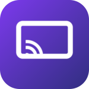

# Mira



A small, open-source **Miracast receiver for Windows**. Mirror an Android phone's
screen to your PC over Wi-Fi — no cables, no phone app, no account.

Built on the first-party [`Windows.Media.Miracast`](https://learn.microsoft.com/uwp/api/windows.media.miracast.miracastreceiver)
API. Around 300 lines of C#.

```
Phone (Cast) ──Wi-Fi Direct / Miracast──▶ Mira ──▶ Your screen
```

---

## Why this is so short

Windows already contains a complete Miracast **sink**: Wi-Fi Direct discovery, the
Miracast control protocol, HDCP, RTP depacketisation, H.264/H.265 decode, audio and
A/V sync. This project is the glue around it.

The whole handoff is one assignment:

```csharp
_session.MediaSourceCreated += (session, args) =>
{
    var player = new MediaPlayer { RealTimePlayback = true };
    player.Source = args.MediaSource;   // decode + render + sync, handled by the OS
    player.Play();
};
```

## Screenshots

<!--
Once docs/screenshot.png exists, delete these comment markers to publish it:


-->

_No screenshot is committed yet. Capture one yourself with the helper script — run
it while the app is open, and it crops to just the app window rather than grabbing
your whole desktop:_

```powershell
.\scripts\capture-screenshot.ps1 -WindowTitle "Mira"
```

## Features

- Receive Miracast / "Wireless display" / Smart View / Cast Screen from Android
- Video **and** audio
- Auto-fullscreen on connect — `Esc` to exit, `F` to toggle
- Configurable device name (what your phone shows in the cast list)
- Connection takeover (a new phone can take over without restarting)
- One-click **Restart service** — for when the phone can't find the PC
- Built-in event log for troubleshooting

## Requirements

**To run**
- Windows 10 **2004 (build 19041)** or later
- A Wi-Fi adapter whose driver supports **Wi-Fi Direct** (most Intel, Qualcomm and
  MediaTek chips do — check with the built-in-feature script below)
- An Android phone that still supports Miracast

**To build**
- Visual Studio 2022 with the **Universal Windows Platform development** workload
- Windows 10 SDK **10.0.19041.0** or later
- Developer Mode enabled

## Two ways to use this

**1. `Mira.exe` — a 37 KB desktop app. No SDK, no Visual Studio, no download.**

Build it in about a second:

```powershell
.\scripts\build-app.ps1 -Shortcut
```

Then double-click `dist\Mira.exe`. It starts Windows' Miracast receiver, shows you
whether it's running, walks you through connecting your phone, and sits in the tray.

It is compiled with the C# compiler **already inside Windows**, so there is nothing to
install.

> **What Mira.exe is and isn't.** Windows only lets a program render mirrored video if
> it is a packaged UWP app, so a plain desktop app cannot draw the video itself. Mira.exe
> therefore *drives* the receiver Windows already contains rather than replacing it —
> the video appears in the receiver window, and Mira is your front end for it. It is
> the useful, tiny option. The full UWP app below is the one that renders video in its
> own window, and it needs the SDK.

**2. The UWP receiver in `src/` — renders video in its own window.**

Requires Visual Studio with the UWP workload (~8–15 GB):

```powershell
# Administrator PowerShell
.\scripts\install-toolchain.ps1
```

Then open `MirrorReceiver.sln`, set the platform to **x64**, press **F5**.

## First-time setup

Whichever route you take, Windows needs its receiver feature switched on once:

```powershell
# Administrator PowerShell
.\scripts\Enable-BuiltInReceiver.ps1
```

That installs Microsoft's "Wireless Display" capability. A reboot may be required.

Then, on the PC, open **Start → "Connect"**, and on the phone go to
**Settings → Connections → Cast / Smart View / Wireless display**.

If the PC never appears on your phone, your Wi-Fi driver or phone lacks Miracast —
and no amount of coding will fix that. Check the script's output.


## Build from source

1. Clone this repo.
2. Open `MirrorReceiver.sln` in Visual Studio 2022.
3. Set the platform to **x64**, configuration **Debug**.
4. `F5` to build and deploy.

To produce an installable package: **Project → Publish → Create App Packages**.
You will need a code-signing certificate; none is committed here.

## How it works

`src/MirrorReceiver/MainPage.xaml.cs` is the entire receiver:

| Step | Call |
|---|---|
| 1 | `new MiracastReceiver()` + `GetDefaultSettings()` |
| 2 | `DisconnectAllAndApplySettingsAsync(settings)` — sets the name your phone sees |
| 3 | `CreateSessionAsync(null)` → `MiracastReceiverSession` |
| 4 | `session.StartAsync()` — begins Wi-Fi Direct advertising and listening |
| 5 | `MediaSourceCreated` → hand the source to `MediaPlayer` |

Session event handlers are written as **lambdas** on purpose. The Microsoft Learn
reference pages for `Windows.Media.Miracast` are stubs with no member lists, so
spelling out the event-args types by hand would be guesswork. Lambda inference lets
the compiler derive them from the event — the same approach the reference sample uses.

## Troubleshooting

| Symptom | Cause / fix |
|---|---|
| PC never appears in the phone's cast list | Different Wi-Fi networks. Put both on the same network, or use a hotspot. |
| PC appears, connection fails | Settings → System → **Projecting to this PC** → set both dropdowns to *"Available everywhere on secure networks"*. |
| Worked before, now nothing | Click **Restart service** in the app. This is why that button exists. |
| "No wireless adapter found" | Miracast requires Wi-Fi. Ethernet-only will not work. |
| Phone has no Cast / Wireless display option | Your phone dropped Miracast. Google Pixel models do not support it. |
| Video but no audio | Check the Windows volume mixer, and see the known limitation below. |

## Known limitations

- **Android only.** Miracast is not an iPhone protocol — there is no iOS equivalent.
  If you need iPhone mirroring you need AirPlay, which is an entirely different stack.
- **Needs Miracast-capable hardware.** Both the Wi-Fi driver and the phone.
  See [Microsoft's requirements](https://support.microsoft.com/windows).
- **No Google Pixel support.** Google removed Miracast from Pixel devices. Apps that
  support those phones do so by shipping their own phone-side app and a custom
  protocol — a much larger undertaking than this project.
- **No QR pairing.** Miracast discovers by device name over Wi-Fi Direct.
- Quality is negotiated by the OS; there are no bitrate or resolution controls exposed
  through this API surface at the time of writing.

## Related reading

- [MiracastReceiver API reference](https://learn.microsoft.com/uwp/api/windows.media.miracast.miracastreceiver)
- [MiracastReceiverSession](https://learn.microsoft.com/uwp/api/windows.media.miracast.miracastreceiversession)
- [KevinKennedy/MiracastReceiverSample](https://github.com/KevinKennedy/MiracastReceiverSample) — minimal reference sample (MIT), used as ground truth for the API calls here

## License

[MIT](LICENSE). See [NOTICE.md](NOTICE.md) for third-party attribution.

## Regenerating assets

The tile and logo PNGs are generated from source, not hand-drawn. The generator uses
only the Python standard library — no Pillow, no ImageMagick:

```bash
python scripts/generate-assets.py
```

Edit the constants at the top of `scripts/generate-assets.py` (gradient colours, mark
geometry, tile radius) and re-run to re-skin the app.
